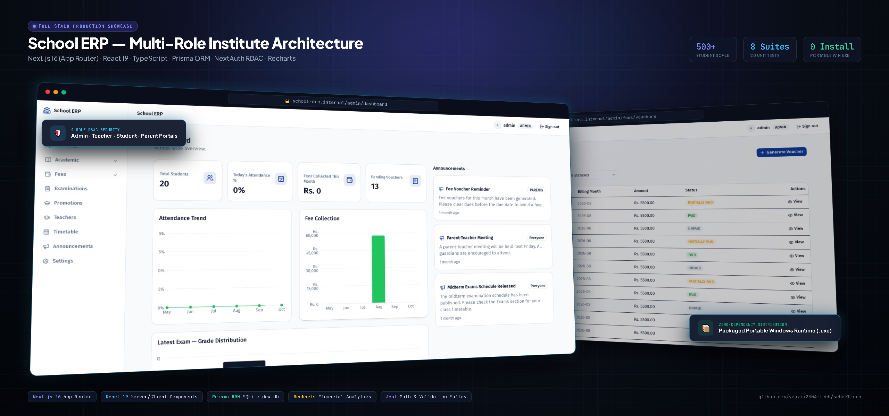
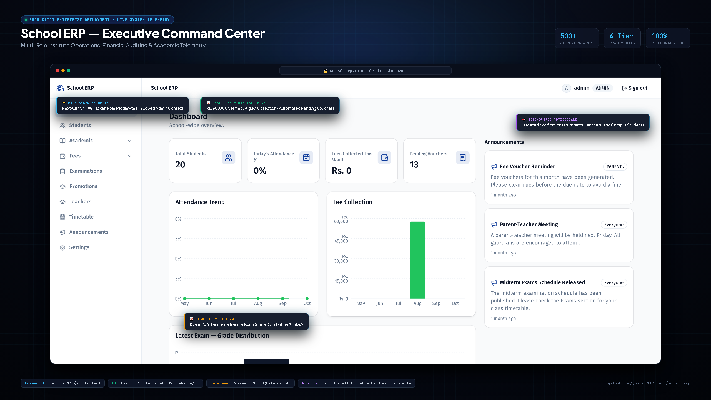
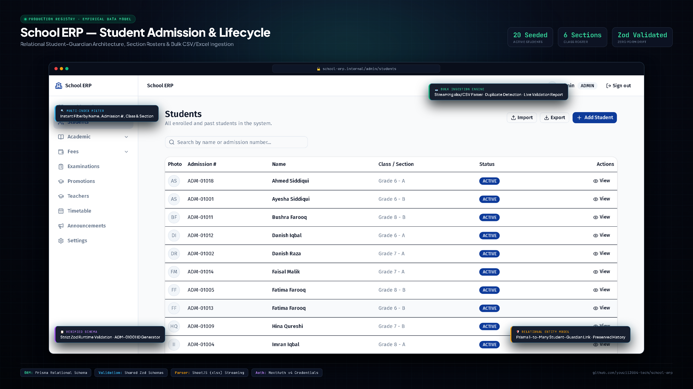
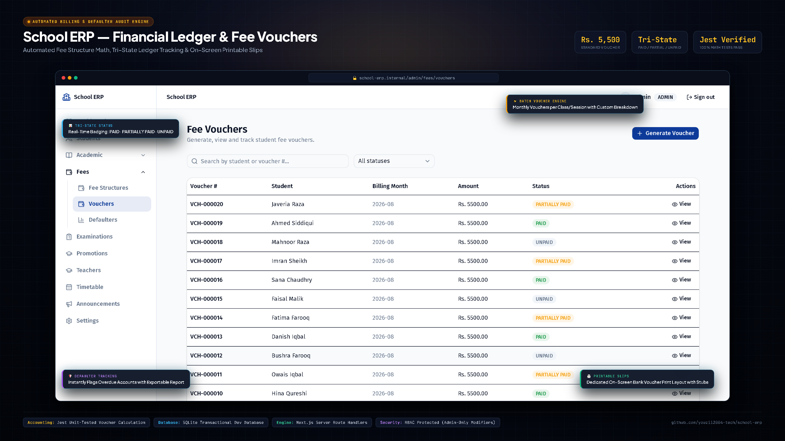

# School ERP

<p align="center">
  
</p>

<p align="center">
  <strong>Enterprise Multi-Role School Management System</strong><br>
  Built with Next.js 16 (App Router), React 19, TypeScript, Prisma ORM, NextAuth RBAC, Recharts & Zero-Install Portable Windows Runtime.
</p>

<p align="center">
  <a href="#executive-command-center">Executive Command Center</a> •
  <a href="#student-lifecycle--admission">Student Lifecycle</a> •
  <a href="#financial-ledger--fee-vouchers">Fee Vouchers</a> •
  <a href="#tech-stack">Tech Stack</a> •
  <a href="#default-seeded-login-credentials">Live Seeded Accounts</a>
</p>

---

## Visual Architecture & Feature Walkthrough

### 1. Executive Command Center
<p align="center">
  
</p>

- **NextAuth v4 RBAC:** Role embedded into JWT session token; route-level middleware protects administrative operations.
- **Dynamic Recharts Telemetry:** Area and bar charts visualize monthly attendance percentages and Rs. 60,000+ fee collection milestones.
- **Role-Scoped Noticeboard:** Real-time school announcements broadcast to specific roles (Parents, Teachers, All Campus).

---

### 2. Student Lifecycle & Admission Directory
<p align="center">
  
</p>

- **Prisma Relational Model:** Historical enrollment preserved across sessions, classes, and sections; 1-to-many student-to-guardian linking.
- **Zod Schema Runtime Validation:** Strict validation at both API routes and client form boundaries prevents invalid admissions.
- **Streaming xlsx/CSV Parser:** Bulk student import with duplicate row detection, error reporting, and one-click CSV export.

---

### 3. Financial Ledger & Fee Vouchers
<p align="center">
  
</p>

- **Automated Voucher Engine:** Batch-generates monthly fee vouchers per class/session with parameterized tuition structures.
- **Tri-State Accounting:** Real-time visual tracking across `PAID`, `PARTIALLY PAID`, and `UNPAID` states.
- **Jest-Verified Accounting:** 100% test coverage on voucher calculation and grading math to guarantee zero ledger discrepancies.
- **Printable Bank Slips:** Dedicated on-screen bank voucher print layout with customer and school stubs.

---

## Overview

A School/Institute Management system built for a Pakistani school of roughly 300–500
students, as unpaid favor work for a friend. The friend's original requirement document
described a commercial-grade, ~25-module ERP (library, transport, inventory, multi-campus,
SMS notifications, ID cards, certificate verification, an 8-role permission matrix, and
more). Building all of that was out of scope for unpaid work, so this repo is a
**deliberately scoped-down MVP**: a real, usable core covering students, attendance, fees,
exams/results, teachers, timetable, and announcements, with a genuinely polished
commercial-ERP-style frontend, while explicitly deferring the modules that add complexity
without being essential to daily school operations. See
[`docs/superpowers/specs/2026-08-16-school-erp-mvp-design.md`](docs/superpowers/specs/2026-08-16-school-erp-mvp-design.md)
for the full design rationale, and the "What's included / What's deferred" section below
for the exact scope line.

## Tech stack

- **Framework:** Next.js 16.3.1 (App Router, TypeScript), single deployable process —
  Next.js API routes are the backend, there is no separate server.
- **Database:** SQLite via Prisma ORM (`prisma/dev.db`), swappable to a real file path in
  production. No separate database server to provision.
- **Auth:** NextAuth.js v4, Credentials provider (username + password), bcrypt password
  hashing, JWT session strategy, role embedded in the session token.
- **UI:** Tailwind CSS + shadcn/ui component primitives, one consistent design-token set
  (colors, radii, spacing).
- **Charts:** Recharts, for the admin dashboard's attendance/fee/result visualizations.
- **Validation:** Zod, shared between forms and API route handlers.
- **Import/export:** `xlsx`, for CSV/Excel student bulk import and CSV export.
- **Testing:** Jest (`ts-jest`) for focused unit tests on core business logic
  (password hashing, CRUD validation, voucher/grading math).

## Prerequisites

- Node.js 20+ (this repo was built and verified against Node v24; Next.js 16 requires a
  current LTS or newer Node — anything older than 20 is not supported).
- npm (the project was scaffolded and has only ever been installed with `npm install`,
  not `npm ci` or another package manager — there is no committed lockfile assumption
  beyond that).

## Setup

```bash
npm install
cp .env.example .env      # already checked in — see note below
npx prisma migrate dev
npx prisma db seed
npm run dev
```

Then open `http://localhost:3000` and sign in with one of the seeded accounts below.

**Note on `.env`:** `.env.example` is checked into this repo with the three variables the
app reads (`DATABASE_URL`, `NEXTAUTH_SECRET`, `NEXTAUTH_URL`); a working `.env` for local
development is *also* already checked in (this is a favor project running on a single
local/self-hosted machine, not a multi-environment deployment — see
[`docs/ARCHITECTURE.md`](docs/ARCHITECTURE.md) for the full environment-variable list,
including the optional `NEXT_PUBLIC_INSTITUTE_NAME`). If you're setting this up fresh
elsewhere, copying `.env.example` to `.env` and generating your own `NEXTAUTH_SECRET` is
still the right move — don't reuse the dev secret in anything resembling production.

`npx prisma migrate dev` is this project's actual migration convention (confirmed against
the three migrations already in `prisma/migrations/`) — not `migrate deploy` or `db push`.

## Default seeded login credentials

Running `npx prisma db seed` wipes and repopulates the database with demo data (3 classes,
6 sections, 6 subjects, 3 teachers, 20 students with guardians, a mix of paid/partially-paid/
unpaid fee vouchers, a published midterm exam with marks, and a few announcements) and
prints these same credentials to the console. They come straight from `prisma/seed.ts` —
copied here verbatim, not invented:

| Role | Username | Password |
|---|---|---|
| Admin | `admin` | `Admin@12345` |
| Teacher | `teacher.sarah` | `Teacher@12345` |
| Student | `student.demo` | `Student@12345` |
| Parent (1st linked guardian) | `parent.demo1` | `Parent@12345` |
| Parent (2nd linked guardian) | `parent.demo2` | `Parent@12345` |

The seed script also creates two more teacher user accounts (`teacher.usman`,
`teacher.nadia`) with the same `Teacher@12345` password, but doesn't print them — they
exist for teacher-assignment variety in the demo data, not as a primary demo login.

Re-running `npx prisma db seed` is safe any number of times — it deletes all seed-owned
rows first, so it never duplicates data.

## Tests and production build

```bash
npm test                    # Jest — unit tests for auth, CRUD validation, voucher/grading math
npm run build && npm start  # production build, then serve it
```

## Portable Windows build (no installs on the target PC)

```bash
npm run build:portable
```

Produces a `dist/` folder containing `Start School ERP.exe` — copy the whole
folder to any Windows PC and double-click that exe; it starts the server and
opens the app in the browser automatically. No Node, Docker, or `npm
install` needed on the target machine. See
[`docs/PACKAGING.md`](docs/PACKAGING.md) for how it works, how to rebuild
after code changes, and how to keep a school's real data safe across
rebuilds. When handing the `dist/` folder to a non-technical person, send
[`docs/START_HERE_FOR_YOUR_FRIEND.md`](docs/START_HERE_FOR_YOUR_FRIEND.md)
along with it — it's written for them, not a developer.

As of the last verification pass (Task 27), `npm test` passes 8 suites / 20 tests, and
`npm run build` compiles cleanly with zero TypeScript errors across all routes and pages.
`npm run lint` has a documented set of non-functional, deferred lint warnings (mostly a
strict `react-hooks/set-state-in-effect` rule flagging a common, working "reset dialog
state on open" pattern) — see Task 27's report for the full breakdown; nothing in that
list is a real bug.

## What's included in v1

- **Auth** — credentials login, bcrypt hashing, JWT session, role-based route middleware.
- **Students & Guardians** — full profile, guardian linkage, document upload, admission
  workflow (enroll into class/section/roll number).
- **Academic structure** — academic sessions, classes, sections, subjects, all
  session-scoped so historical data is never overwritten.
- **Attendance** — daily marking (Present/Absent/Late/Leave), monthly percentage view.
- **Fees** — fee structures per class, voucher generation, on-screen print view, payment
  recording, defaulter report.
- **Examinations & Results** — exam + subject configuration, marks entry, auto-calculated
  total/percentage/grade/position, publish-and-lock (published results become read-only).
- **Marksheets** — on-screen report card view per student per exam.
- **Teacher management** — profile, subject/class assignment.
- **Timetable** — simple grid CRUD (no auto-conflict solver).
- **Announcements** — targeted to all / a role / a class.
- **Class promotion** — bulk move students from one class/section into the next, recorded
  as history rows.
- **Role dashboards** — Admin gets school-wide stats and charts; Teacher/Student/Parent get
  scoped summaries.
- **Document upload** — student documents and photos, stored on local disk.
- **CSV/Excel import & export** — bulk student import with a preview-before-commit step
  (duplicate detection, per-row error report), and a CSV export of the student list.
- **Settings** — institute profile (name/contact/address), configurable grading bands,
  current-session control.
- **Soft delete** — students, fee records, and exam/mark records use a `deletedAt` column;
  the UI never exposes a hard delete for these.
- **Demo seed script** — so the app is never empty on first run.

## What's deferred (explicitly out of scope for v1)

Copied from the spec's Non-Goals, so it isn't lost:

- Library management, transport management, inventory/asset management.
- Multi-campus support.
- SMS/email sending integration (no provider wired up, no actual sending).
- Certificate generation + public verification page, student ID card generation.
- Real PDF export — vouchers/marksheets/report cards are on-screen only in v1 (printable
  via the browser's own print dialog, not a generated PDF file).
- Scheduled/automated backups (a manual copy of the SQLite file is enough at this scale).
- The full 8-role permission matrix from the original spec — Super Admin, Accountant, Exam
  Officer, and Reception are all merged into a single Admin role for v1.
- A full granular audit log of every event — v1 only guarantees soft delete plus basic
  created/updated timestamps, not a per-field change history.

If any of these are wanted later, see [`docs/ARCHITECTURE.md`](docs/ARCHITECTURE.md)'s
"Deferred modules" section for the smallest concrete next step for each one.

## Further documentation

- [`docs/USER_GUIDE.md`](docs/USER_GUIDE.md) — plain-language guide for school staff
  (Admin, Teacher, Student, Parent), no developer jargon.
- [`docs/ARCHITECTURE.md`](docs/ARCHITECTURE.md) — system architecture, data model, and
  permission enforcement points, for a future developer picking this up.
